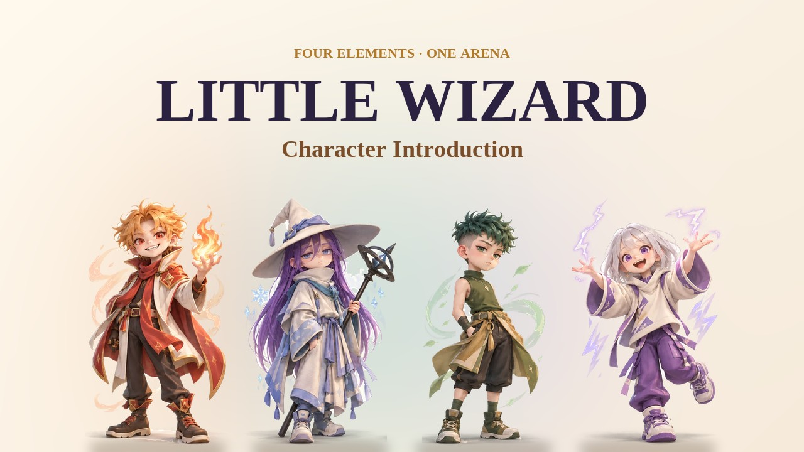
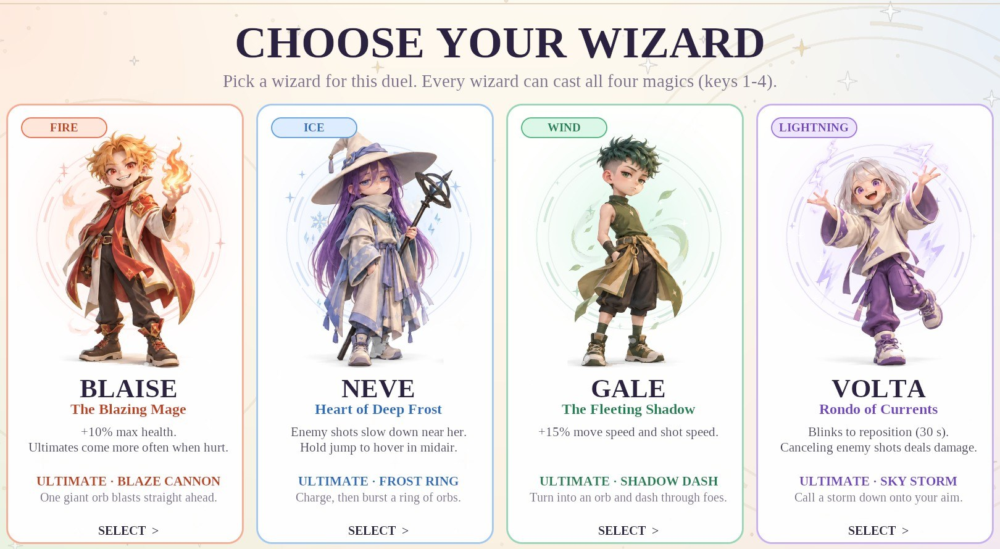
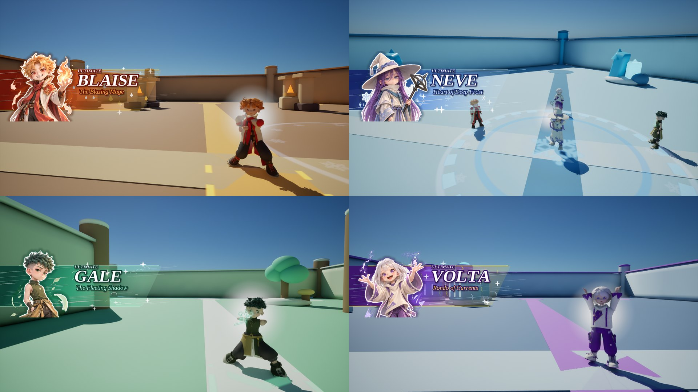
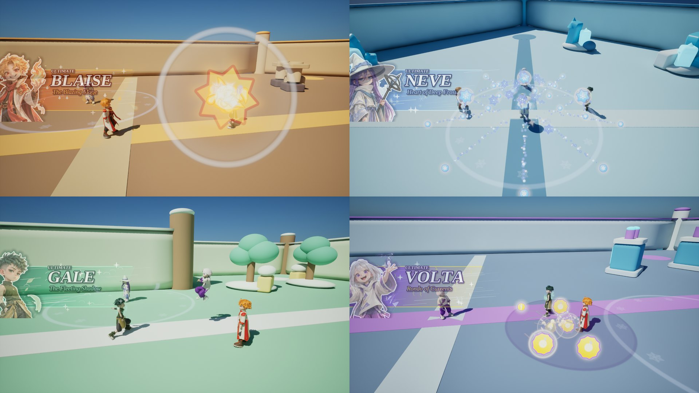
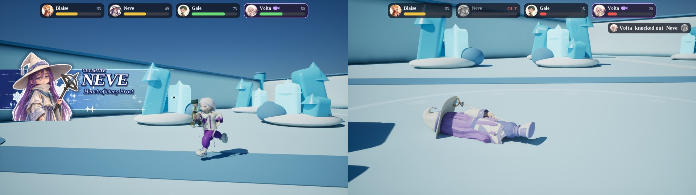
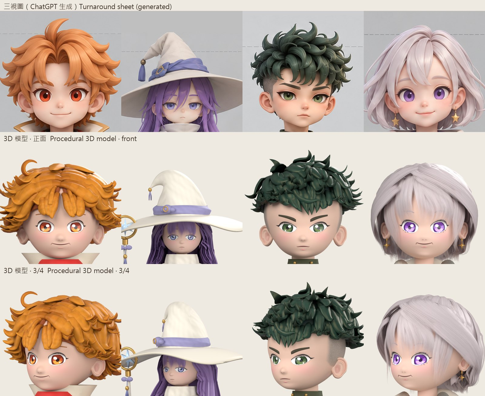
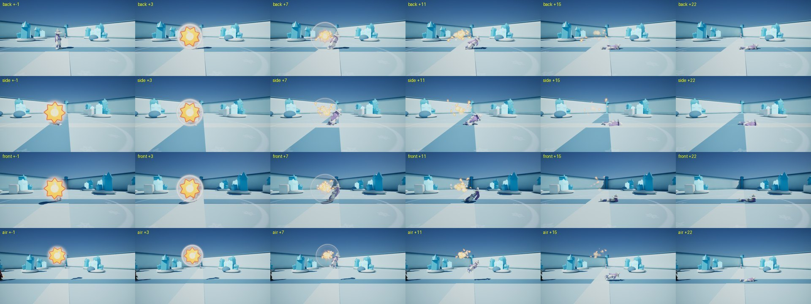

# Little Wizard (小小魔法師)

**English** · [繁體中文](README.zh-TW.md)

**Little Wizard** is a four-player magic battle game made in Unreal Engine 5. Four young wizards (fire, ice, wind and lightning) fight in themed arenas, each with their own traits and ultimate.

I designed the game and built its first playable prototype. I then used two AI coding agents, OpenAI Codex and Claude Code, to build the rest, one round of feedback at a time: in each round I played the latest build, watched the test videos and decided what to change. This page explains what I did, what the AI agents did, and what I learned.

| | |
|---|---|
| **My role** | Game design, prototype and direction (a solo project made with AI coding agents) |
| **Timeline** | Late September to October 2026, about one month |
| **Tools** | Unreal Engine 5.8 (Blueprints), Blender 5.2, Python; ChatGPT, OpenAI Codex, Claude Code |
| **Videos** | Character introductions in four languages and two four-way battles between bots: [Releases](../../releases/latest) |

## My role and the use of AI

I made Little Wizard with AI tools: ChatGPT helped with the prototype and generated the concept art, and two AI coding agents, OpenAI Codex and Claude Code, generated almost all of the code. This section sets out exactly what is mine and what is not.

### 1. My own design and decisions

- **Game design.** The concept (four wizards, four elements, one arena) and its rules: the wizard and the magic are separate choices, so every wizard can cast all four kinds of magic; each magic's orb has a first form and a second-press effect; and each wizard has their own traits. I also gave the wizards their titles and personalities.
- **Direction.** I reviewed every build by playing it and watching the test videos, and decided what to keep and what to change. Some of those decisions:
  - I asked for Gale to be faster. The first attempt (+20% movement, +30% shot speed) felt too fast in play, so both were set to +15%.
  - I wanted ultimates to be rarer, so I asked for 5% and 2.5% to be compared with the old 10% in simulated matches; 5% was chosen (results in the [development log](docs/DEVLOG.md)).
  - A knocked-out wizard should fall the way the blow pushed them, as physically as possible. This became a rigid-body fall driven by the direction of the hit.
  - The 3D faces could not match the charm of the 2D concept art, so I chose the illustration for every portrait in the game: the character select screen, the ultimate cut-ins and the results screen.
  - Each interface language had to be complete on its own, with no mixing. I also chose the fonts, such as LXGW WenKai with Tinos for Chinese.
### 2. AI-generated code and art

- **Code.** Apart from the prototype, the code was generated by the AI agents at my request. Codex built the cooldown and ultimate systems, the match flow and menus, the arenas, the first effects and sounds, and the first four versions of the 3D characters (early October). Claude Code then rebuilt the characters from scratch in Blender Python and generated the 16 ultimates, the animation, the effects, the sound and music, the four-language interface, the knock-out physics, the videos and the scripts in [`tools/`](tools/README.md) (mid to late October). The [development log](docs/DEVLOG.md) lists each round.
- **Art.** The character illustration and the turnaround sheets were generated with ChatGPT from my ideas; every 3D model was compared against them.

### 3. What I understood, tested and changed myself

- **The early mechanics.** I built the first playable version in Unreal Engine Blueprints, step by step with ChatGPT, and changed it myself: the third-person wizard, the fireball and the other three orbs with their second-press effects, and the wizards' traits. These are the parts of the game I know best.
- **Testing.** I tested every build by playing it and watching the test videos, compared each model with the turnaround sheets, and described problems precisely until they were fixed.

### 4. What I cannot yet do on my own

- I cannot yet write most of the code the agents generated, such as the procedural 3D modelling, the animation blueprints, the particle effects, the sound synthesis and the video pipeline.
- I cannot yet make the 3D art myself.

## Screenshots

**Choosing a wizard**

**Ultimate wind-ups, each with the wizard's cut-in card**

**The four ultimates: Blaze Cannon, Frost Ring, Shadow Dash and Sky Storm**

**A four-way battle in the game's third-person camera, and a knock-out close-up**

**The interface in Traditional Chinese and Japanese (English and French are also available)**

**Turnaround sheets generated with ChatGPT (top) and the procedural 3D heads, front and three-quarter views**

**Knock-out tests: hit from behind, from the side, from the front and in mid-air**

## The wizards

| Wizard | Element · title | Traits | Ultimate |
|---|---|---|---|
| **Blaise** | Fire · The Blazing Mage | +10% maximum health; ultimates come more often when he is hurt | **Blaze Cannon**: one giant orb blasts straight ahead |
| **Neve** | Ice · Heart of Deep Frost | Enemy shots slow down near her; holding jump in mid-air lets her hover | **Frost Ring**: she charges, then bursts a ring of orbs |
| **Gale** | Wind · The Fleeting Shadow | +15% movement and shot speed | **Shadow Dash**: he becomes an orb and dashes through enemies |
| **Volta** | Lightning · Rondo of Currents | Blinks to reposition (30 s cooldown); cancelling an enemy shot also damages its caster | **Sky Storm**: a storm strikes where she aims |

## Features

- **Character × magic.** The wizard is chosen before the match; the magic can be switched at any time with keys 1–4. Pressing Q while a shot is in flight triggers its second-press effect: fire detonates, ice splits into shards, wind homes in on the nearest enemy, and lightning drops an electric field. Guarding (right mouse button) cuts damage to 40%.
- **16 ultimates.** The wizard decides how the ultimate is delivered (cannon, ring, dash or storm) and the current magic decides what it does, giving 4 × 4 combinations. Each time a spell comes off cooldown, there is a base 5% chance that the ultimate becomes ready.
- **Physical knock-outs.** A knocked-out wizard topples in the direction of the blow, like a rigid body falling about its feet, and bounces slightly on landing; if hit in mid-air, they first fall to the ground under gravity.
- **Modes and arenas.** Last Stand (one life each) and Timed Duel (three minutes); five themed arenas with procedurally generated layouts; online multiplayer and a practice mode.
- **Four languages.** English, Traditional Chinese, Japanese and French, each with its own fonts.

## How it was built

**The loop.** Each round started with my feedback on the previous build. The AI agent changed its scripts, rebuilt the characters and the Blueprints, ran the checks (compiling all 59 Blueprints, validating each model, play-in-editor tests) and recorded new test videos for my next review.

**Built by scripts.** Most of the final game is generated by Python scripts that drive Blender and Unreal Engine, so any part can be rebuilt from scratch:

| Part | Approach | Main scripts ([`tools/`](tools/README.md)) |
|---|---|---|
| 3D characters | Built from scratch in Blender Python: heads as smooth unions of ellipsoids; eyes and eyelids with blink and A-I-U-E-O mouth morph targets; sculpted hair clumps and hair cards; garments with fabric textures; rigs of 80–127 bones with physics chains for hair and cloth | `build_wizard_models_v5.py`, `wizard_hair_v5.py`, `wizard_outfit_v5.py`, `wizard_fabric_v5.py` |
| Checks | Every build tests the FBX round trip, the skin weights and whether closed eyelids fully cover the eyes, and overlays the model on the turnaround sheets at the same scale | `validate_wizard_v5.py`, `render_compare_v5.py`, `package_v5.py` |
| Unreal Engine | Blueprint graphs edited from Python; Animation Blueprints (pose copying, foot IK, per-bone AnimDynamics); Niagara effects; UMG menus and the language system | `r11_bp.py`, `import_wizard_models_v5.py`, `r11_ultimates.py`, `r11_vfx.py`, `r15_lang.py`, `r20_death_fall.py` |
| Sound and music | 47 sound effects and 7 music pieces synthesized with NumPy (oscillators, FM, envelopes, filters, reverb) | `r13_synth.py`, `r13_instruments.py`, `r13_sfx.py`, `r13_music.py` |
| Videos | Frame-by-frame capture at a fixed time step, with the game's sound recorded in sync; battles played by bots; title cards, per-language ultimate cut-ins, health bars and a kill feed added in post-production | `r20_intro.py`, `r20_intro_post.py`, `r20_battle.py`, `r20_battle_post.py` |

**Tech:** Unreal Engine 5.8 (Blueprints, Animation Blueprints, Niagara, UMG, replication) · Blender 5.2 (bpy) · Python (NumPy, SciPy, Pillow, fontTools) · Diversion version control

## What I learned

- **Precise feedback gets results; vague feedback does not.** Early on, I adjusted the character models many times without getting the look I wanted. What worked was comparing each build with the turnaround sheets at the same scale and naming exactly what was wrong, for example "her eyes are too close together" or "there is a stray strand of hair".
- **The AI builds; judging is still the human's job.** The agents could implement almost anything I asked, and quickly, but they could not tell whether it felt right. Speeds, timing and faces were only settled by playing and watching, and some changes were rejected and rolled back.
- **Turn opinions into experiments.** Instead of guessing how rare ultimates should be, we ran simulated four-bot matches: at 5% each wizard gets an ultimate about every 25 seconds, while at 2.5% half of them never get one.
- **Design around your limits.** Art is not my strength, and the 3D faces never reached the charm of the 2D art, so the illustration represents the characters wherever a portrait is shown.

## Credits

- **Sem Jia Le**: game design, prototype, direction and art direction
- **Fonts**: Tinos, LXGW WenKai TC and Noto Sans JP (SIL Open Font License 1.1); Roboto (Apache License 2.0, bundled with Unreal Engine)

How the AI tools were used is set out in [My role and the use of AI](#my-role-and-the-use-of-ai).

© 2026 Sem Jia Le ([FrogFrorge](https://github.com/FrogFrorge)). All rights reserved. This repository has no open-source licence, so please ask before reusing its code or images; the fonts keep their own licences.
