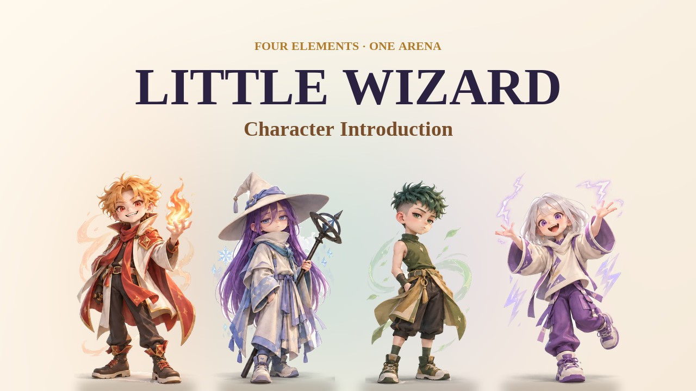
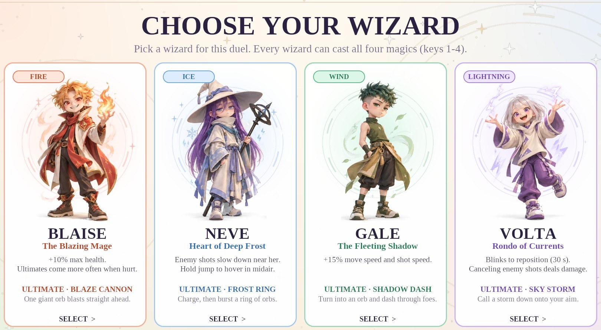
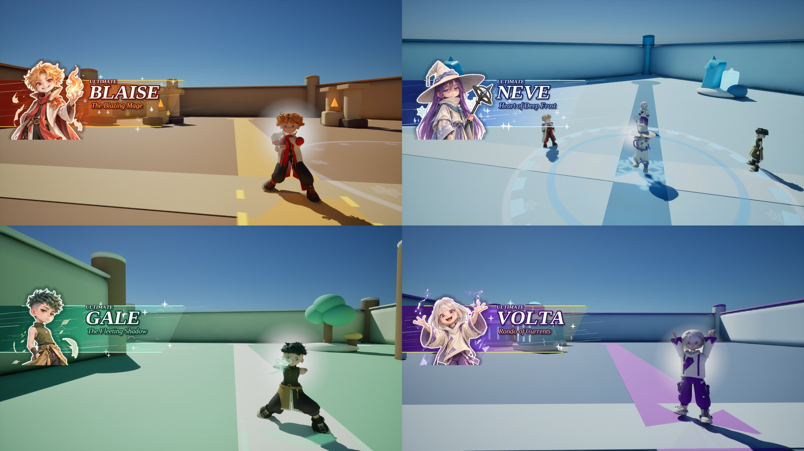
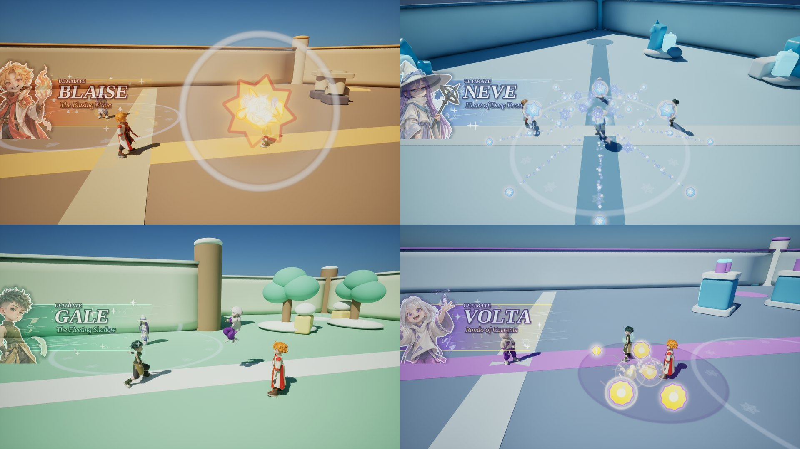
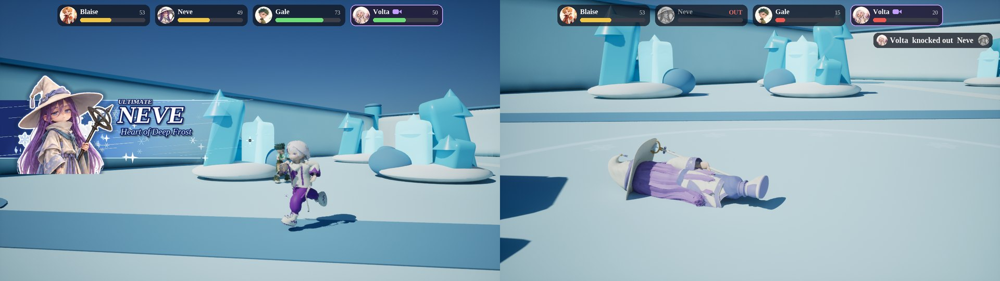
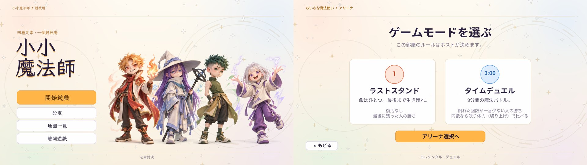
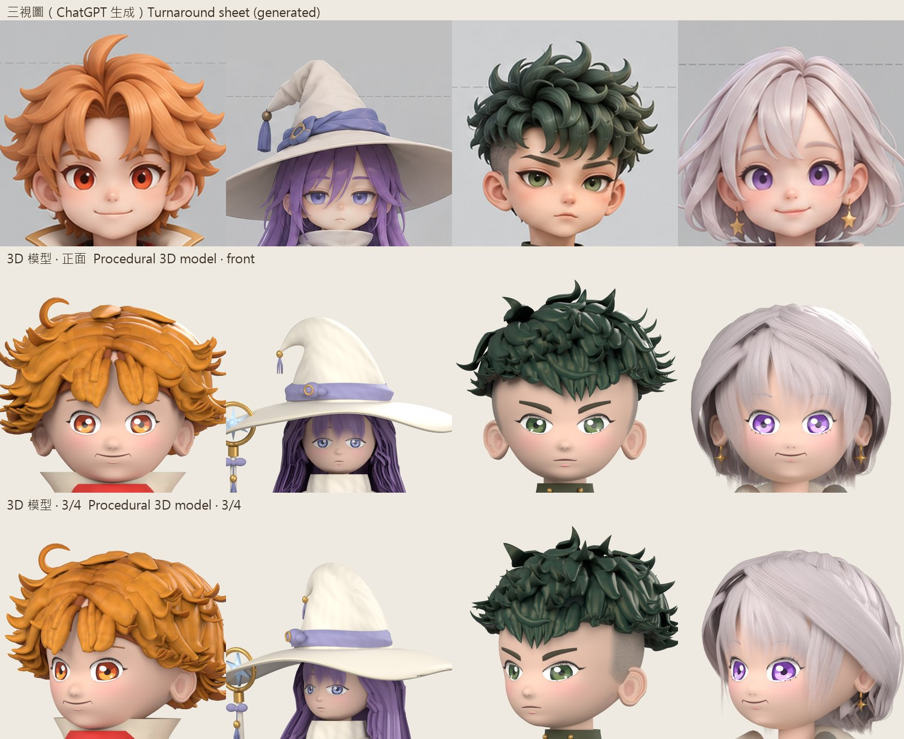
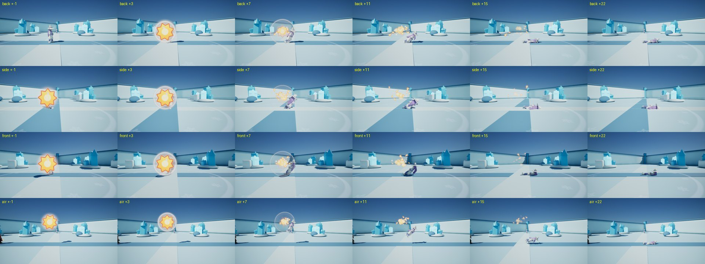

# 小小魔法師 Little Wizard

[English](README.md) · **繁體中文**

**小小魔法師**是用 Unreal Engine 5 製作的四人魔法對戰遊戲。火、冰、風、雷四位小魔法師在不同主題的競技場裡對決，每位都有自己的特性和大招。

這款遊戲由我設計，第一個可以玩的原型也是我做的。之後我指揮 AI 程式助理完成其餘的部分，一輪一輪地修改：每一輪我都試玩最新的版本、看測試影片，再決定下一步要改什麼。這一頁說明哪些是我做的、哪些是 AI 做的，以及我學到了什麼。

| | |
|---|---|
| **我的角色** | 遊戲設計、原型製作與開發方向（一人專案，與 AI 程式助理合作） |
| **製作期間** | 2026 年 9 月下旬到 10 月，約一個月 |
| **工具** | Unreal Engine 5.8（藍圖）、Blender 5.2、Python；ChatGPT、OpenAI Codex、Claude Code |
| **影片** | 四種語言的角色介紹，以及兩場電腦 AI 的四人對戰：[Releases](../../releases/latest) |

## 我的角色

遊戲由我設計，原型由我製作，之後的開發也由我主導；原型之後的程式和 3D 模型由 AI 撰寫。

- **遊戲設計**：遊戲的概念（四位魔法師、四種元素、一個競技場）和規則：角色和魔法是兩個獨立的選擇，所以每位魔法師都能使用四種魔法；每種魔法的法球都有第一形態和二段效果；每位魔法師都有自己的特性。魔法師的稱號和個性也是我定的。
- **原型**：我用 Unreal Engine 的藍圖，在 ChatGPT 一步一步的協助下，做出第一個可以玩的版本：第三人稱的魔法師、火球和另外三種法球及它們的二段效果，以及各角色的特性。
- **開發方向**：每一版我都實際試玩、看測試影片，決定哪些保留、哪些要改。例如：
  - 我希望蓋爾更快。第一次調整（移動 +20%、子彈 +30%）實際玩起來太快，最後兩者都定在 +15%。
  - 我希望大招少一點，請 AI 用模擬對戰比較 5%、2.5% 和原本的 10%，最後選了 5%（結果見[開發紀錄](docs/DEVLOG.zh-TW.md)）。
  - 被擊倒時要「盡可能符合物理，什麼方向被打，就用什麼角度倒下」，後來做成依被打方向翻倒的剛體物理。
  - 3D 模型的臉比不上 2D 概念圖的可愛，所以我決定遊戲裡所有的立繪都用插畫：選角畫面、大招立繪卡和結算畫面。
  - 每種介面語言都要完整，不能混用其他語言；字型也是我選的，例如中文用霞鶩文楷配 Tinos。
- **美術方向**：角色插畫和三視圖是依我的構想用 ChatGPT 生成的，每個 3D 模型都以它們為比對的基準。

**AI 做了什麼**：ChatGPT 協助製作原型，並生成概念圖。接著 OpenAI Codex 加入了冷卻與大招系統、對戰流程和選單、競技場、最初的特效和音效，以及前四版的 3D 角色（10 月上旬）。最後 21 輪由 Claude Code（Anthropic）負責（10 月中下旬）：用 Blender Python 從零重做角色，並撰寫新的特效、16 種大招、動畫、音效與音樂、四種語言的介面、倒地物理和所有影片，每一輪都會跑自動檢查。每一輪的內容見[開發紀錄](docs/DEVLOG.zh-TW.md)。

## 畫面

**選擇魔法師**

**大招起手，以及每位魔法師的大招立繪卡**

**四種大招：爆炎巨砲、霜之環、影之衝刺、天降雷暴**

**四人對戰：遊戲本身的第三人稱鏡頭，以及擊倒特寫**

**繁體中文和日文的介面（另有英文和法文）**

**用 ChatGPT 生成的三視圖（上），以及程式化生成的 3D 頭部（正面和斜側面）**

**倒地測試：從背後、側面、正面和空中被擊倒**

## 角色

| 魔法師 | 元素・稱號 | 特性 | 大招 |
|---|---|---|---|
| **布萊茲 Blaise** | 火・爆炎魔法師 | 最大生命值 +10%；受傷時更容易拿到大招 | **爆炎巨砲**：向正前方轟出一顆巨大的法球 |
| **妮芙 Neve** | 冰・沉凍之心 | 靠近她的敵人子彈會變慢；在空中按住跳躍可以浮空 | **霜之環**：蓄力後向四周炸出一圈法球 |
| **蓋爾 Gale** | 風・瞬影 | 移動速度和子彈速度 +15% | **影之衝刺**：化身法球，衝穿敵人 |
| **沃爾妲 Volta** | 雷・輪舞之流 | 可以閃現換位（冷卻 30 秒）；抵銷敵人的子彈時，也會對那位魔法師造成傷害 | **天降雷暴**：在準星的位置召喚雷暴 |

## 遊戲特色

- **角色 × 魔法**：角色在比賽前選好；魔法隨時可以用 1–4 鍵切換。子彈飛行時按 Q 會觸發「二段」：火球空中引爆、冰球分裂成碎片、風球轉向追蹤最近的敵人、雷球劈出一片雷場。按住右鍵格擋時，只受 40% 的傷害。
- **16 種大招**：大招「怎麼放」由角色決定（巨砲、法環、衝刺、天降），「放出什麼」由當下的魔法決定，共 4 × 4 種組合。每次魔法冷卻結束，都有基礎 5% 的機率蓄好大招。
- **物理倒地**：被擊倒的魔法師會像剛體一樣繞著腳底、往被打的方向翻倒，著地時微微反彈；在空中被擊倒時，會先依重力落到地面。
- **模式與競技場**：背水一戰（每人一條命）和限時決鬥（三分鐘）；五個主題競技場，地形由程式生成；可以連線對戰，也有練習模式。
- **四種語言**：English、繁體中文、日本語、Français，每種語言都有自己的字型。

## 製作方式

**每一輪的流程**：每一輪從我對上一版的意見開始。AI 程式助理修改腳本，重新生成角色和藍圖，跑完檢查（編譯全部 59 個藍圖、驗證每個模型、在編輯器裡實際遊玩測試），再錄下新的測試影片給我看。

**用腳本生成**：最終版遊戲的大部分內容是由 Python 腳本驅動 Blender 和 Unreal Engine 產生的，所以任何部分都可以從頭重新生成：

| 部分 | 做法 | 主要腳本（[`tools/`](tools/README.md)） |
|---|---|---|
| 3D 角色 | 用 Blender Python 從零生成：頭部是多個橢球的平滑聯集；眼睛和眼皮有眨眼與 A I U E O 口型的變形目標；程式雕刻的髮束加上髮片；衣服和布料紋理；80–127 根骨頭的骨架，頭髮與衣物有物理鏈 | `build_wizard_models_v5.py`、`wizard_hair_v5.py`、`wizard_outfit_v5.py`、`wizard_fabric_v5.py` |
| 檢查 | 每次生成都自動檢查 FBX 往返、蒙皮權重、閉眼時眼皮是否完全蓋住眼睛，並和三視圖以相同比例疊圖比對 | `validate_wizard_v5.py`、`render_compare_v5.py`、`package_v5.py` |
| Unreal Engine | 用 Python 編輯藍圖節點；動畫藍圖（姿勢複製、腳部 IK、每根骨頭的 AnimDynamics）；Niagara 特效；UMG 介面和語言系統 | `r11_bp.py`、`import_wizard_models_v5.py`、`r11_ultimates.py`、`r11_vfx.py`、`r15_lang.py`、`r20_death_fall.py` |
| 音效與音樂 | 47 個音效和 7 首配樂，全部用 NumPy 合成（振盪器、FM、包絡、濾波、混響） | `r13_synth.py`、`r13_instruments.py`、`r13_sfx.py`、`r13_music.py` |
| 影片 | 以固定時間步長逐格拍攝，同步錄下遊戲的聲音；對戰由電腦 AI 進行；字卡、各語言的大招立繪卡、血條和擊倒訊息在後製加入 | `r20_intro.py`、`r20_intro_post.py`、`r20_battle.py`、`r20_battle_post.py` |

**技術**：Unreal Engine 5.8（藍圖、動畫藍圖、Niagara、UMG、連線複製）・Blender 5.2（bpy）・Python（NumPy、SciPy、Pillow、fontTools）・Diversion 版本控制

## 我學到的事

- **具體的意見才有效，模糊的意見沒有用。** 一開始，我調整角色模型很多次，都調不出想要的樣子。後來有效的做法是：每一版都和三視圖以相同比例對照，並明確指出哪裡不對，例如「眼睛太密」、「頭髮有一條莫名其妙的」。
- **AI 負責做，判斷還是人的工作。** AI 幾乎能做出我要求的任何東西，而且很快，但它無法判斷感覺對不對。速度、節奏和臉，都是實際玩過、看過之後才定案的；也有一些修改被我否決、退回原本的版本。
- **把意見變成實驗。** 大招該多稀有，不靠猜，而是跑模擬的四人電腦對戰：5% 時每位魔法師大約每 25 秒拿到一次大招；2.5% 時則有一半的魔法師一次都拿不到。
- **依自己的限制來設計。** 美術不是我的強項，3D 模型的臉也一直比不上 2D 插畫的可愛，所以遊戲裡凡是需要立繪的地方，都用插畫來代表角色。

## 製作名單

- **沈家樂**：遊戲設計、原型製作、開發方向與美術方向
- **ChatGPT**（OpenAI）：一步一步協助製作原型；依沈家樂的構想生成角色插畫和三視圖
- **OpenAI Codex**：早期的系統、選單、競技場、特效、音效，以及最初的角色模型（2026 年 10 月上旬）
- **Claude Code**（Anthropic）：最終版的角色、特效、大招、動畫、介面、音效、音樂和影片，以及 [`tools/`](tools/README.md) 裡的腳本（第 1–21 輪，2026 年 10 月）
- **字型**：Tinos、霞鶩文楷 TC、Noto Sans JP（SIL Open Font License 1.1）；Roboto（Apache License 2.0，Unreal Engine 內附）

© 2026 沈家樂（[FrogFrorge](https://github.com/FrogFrorge)）。保留所有權利。這個倉庫沒有開放原始碼授權，使用其中的程式或圖片前請先徵求同意；字型依各自的授權。
